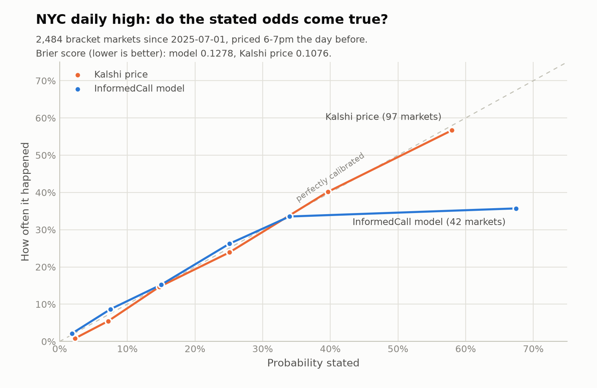

# InformedCall

**Quant-grade forecasts from real-world signals.**

> Not investment advice. Nothing here is a recommendation to buy, sell, or bet on anything, and no real money was traded.

**Status: exploration concluded (October 2026).** The hypothesis did not hold up, and the write-up below is the product.

## The question

Can public real-world data (weather models, station observations, radar) produce probabilities that beat the prices on Kalshi's recurring weather markets, after fees?

## What I built

- **Ingest:** Kalshi markets and hourly bid/ask history (stitching the live and historical endpoints), NWS daily climate reports, archived day-ahead forecasts from three weather models, station observations, and NEXRAD radar composites reduced to rain-coverage features.
- **Label validation:** before modelling, I checked that my reading of each market's rules reproduces Kalshi's recorded settlements.
- **Models:** a calibrated day-ahead baseline for daily-high brackets, plus intraday nowcasts that add the temperature so far (temperature) or radar (rain).
- **Backtest:** trained on earlier days, tested on later ones, priced at the bid/ask a trader would have faced, with taker fees.

## Results

| Test | Finding |
|---|---|
| Labels vs Kalshi settlements | 99.98% agreement on 9,757 NYC high-temp markets; 100% on the current rain series |
| Day-ahead NYC daily high | Brier 0.128 (model) vs 0.108 (market). Simulated trading: about -2.5 cents per contract |
| Intraday temperature, 1pm to 7pm | Market better at every hour, and the gap widens as the day goes on |
| Same-day rain with radar | Radar adds about 0.004 AUC over the forecast alone; the market ranks days better than either |



Both are well calibrated, but the market is sharper. Two independent tests found no lag between public weather data and prices in NYC, which suggests those markets are efficient for anyone using public data at this level.

## What I learned

- **Market data is messy.** Several ticker generations exist per city, and rules changed between them (the older rain series counted a trace of rain as rain; the newer one counts it as zero). Labels have to follow each series' own rule.
- **Check the target before the model.** Reproducing the settlements first caught a trace-rain rule change and a legacy schema that would have silently corrupted training data.
- **A fair test needs the trader's information.** My observation data understated the running high, so the intraday temperature test could not settle the question on its own. One-minute station data had spikes and still did not match the official high.
- **Signal is not edge.** Radar features predicted rain well on their own, but the forecast already contained that information.

## Limitations

- Baseline models only: fixed error widths, a simple blend, and coarse radar features with no storm motion.
- NYC only for backtests; other cities have less history.
- Maker fees are not modelled, and fees follow third-party descriptions of Kalshi's schedule.
- Roughly 2.5 years of archived forecasts limits the test window.

Details, tables, and data quirks are in [docs/market-notes.md](docs/market-notes.md).

## Reproduce

Requires [uv](https://docs.astral.sh/uv/). Kalshi market data needs no API key.

```
uv sync
uv run python -m informedcall.ingest.kalshi KXHIGHNY
uv run python -m informedcall.ingest.kalshi KXRAINNYC
uv run python -m informedcall.ingest.kalshi KXRAIN --suffix=-NYC
uv run python -m informedcall.ingest.actuals KNYC --start 2021
uv run python -m informedcall.ingest.forecasts nyc --lat 40.7794 --lon=-73.9692
uv run python -m informedcall.ingest.candles KXHIGHNY --since 2024-02-01
uv run python -m informedcall.model.baseline
uv run python -m informedcall.scoring.backtest
```

Raw data lands in `data/` and is git-ignored. Secrets, if ever needed, belong in a local `.env` (see `.env.example`).

## Layout

```
src/informedcall/
  ingest/    Kalshi, climate reports, forecasts, observations, radar, candlesticks
  model/     day-ahead and intraday baselines for temperature and rain
  scoring/   label checks and the fee-aware backtest
docs/        market notes and the calibration chart
```
